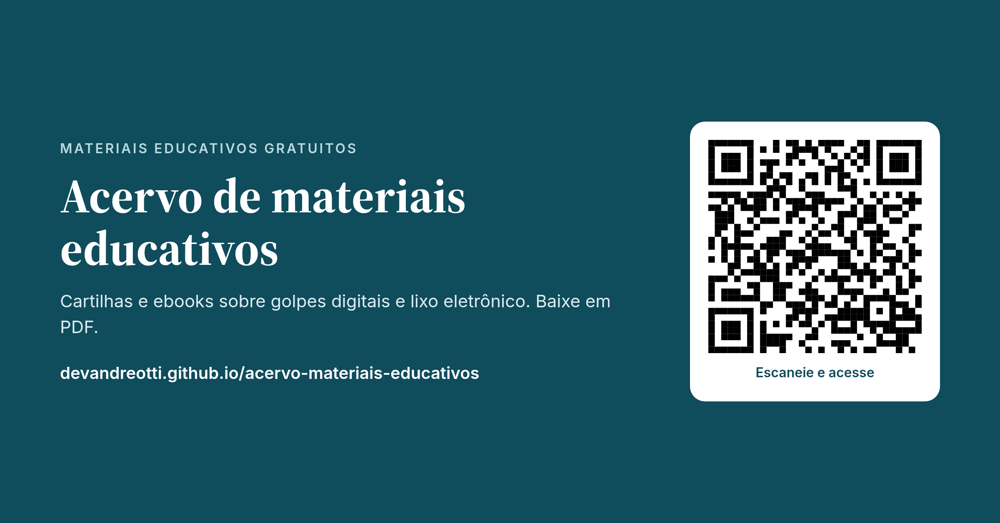
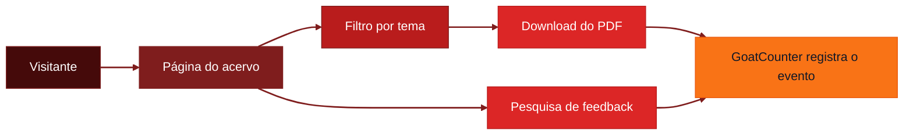

# 📚 Acervo de Materiais Educativos

<p align="center">
  
  
  
  
</p>

<p align="center">
  
  
  
  
  
</p>

<p align="left">
  <strong>Cartilhas, ebooks e infográficos gratuitos, prontos para baixar.</strong><br />
  Um site estático que reúne materiais educativos sobre segurança digital, meio ambiente e IA, com contagem de acessos e downloads.
</p>



> Um acervo simples, sem cadastro e sem anúncios: o material está a um clique e pode ser compartilhado livremente.

---

## 🧭 Visão geral

**Acervo de Materiais Educativos** é um site estático publicado no GitHub Pages. Ele organiza os materiais por tema e permite baixar cada PDF diretamente.

1. **Lista os materiais** por tema, com ODS e status de disponibilidade
2. **Libera os PDFs** de cada atividade (cartilha, ebook ou infográfico)
3. **Conecta cada material** ao formulário de feedback comunitário
4. **Registra acessos e downloads** com o GoatCounter, sem cookies

O foco é publicar materiais de forma clara e sem fricção, mantendo o código simples de manter.

---

## 🎬 Demo

<p align="center">
  
</p>

---

## 🔀 Fluxo



---

## 👥 Para quem é

- Estudantes e professores que querem material pronto para aula ou estudo
- Famílias e responsáveis buscando orientação sobre segurança digital
- Microempreendedores interessados em ferramentas gratuitas de IA
- Qualquer pessoa que queira compartilhar os materiais com outras

---

## 🧰 Stack

- **HTML5 e CSS3** para a estrutura e o layout responsivo, com tema claro e escuro
- **JavaScript** puro para o filtro por tema e a troca de tema
- **GitHub Pages** para publicação, sem servidor
- **GoatCounter** para contagem de visitas e cliques, sem cookies

---

## 📋 Pré-requisitos

*   [x] **Navegador moderno** - para visualizar o site localmente ou online
*   [x] **Git** - para clonar e publicar alterações
*   [x] **Conta no GitHub** - apenas se for publicar sua própria cópia

---

## ⚙️ Configuração

### 1. Clonar o repositório

```bash
git clone https://github.com/devAndreotti/acervo-materiais-educativos.git
cd acervo-materiais-educativos
```

### 2. Contagem de acessos

A contagem usa o GoatCounter. Para usar outra conta, troque o endereço no `index.html`:

```html
<script data-goatcounter="https://SEU-CODIGO.goatcounter.com/count" async src="//gc.zgo.at/count.js"></script>
```

| Variável | Descrição | Exemplo |
|---|---|---|
| `SEU-CODIGO` | Código da sua conta no GoatCounter | `devandreotti` |

### 3. Testar localmente

```bash
python3 -m http.server 8000
```

Depois abra `http://localhost:8000` no navegador.

---

## 🚀 Uso

### Fluxo diário

1. Coloque o PDF novo em `materiais/`
2. Abra o `index.html` e troque o card da atividade: remova a classe `locked`, adicione os links e o botão de pesquisa
3. Confira localmente com o servidor de teste
4. Faça commit e push para a branch `main`

### Exemplo

```bash
git add materiais/novo-material.pdf index.html
git commit -m "feat: libera novo material"
git push origin main
```

### O que fazer depois

- Conferir se o GitHub Pages terminou o build (aba **Actions** ou **Settings → Pages**)
- Verificar os eventos no painel do GoatCounter
- Atualizar o selo de publicação quando um post novo for ao ar

---

## 🗂️ Estrutura do projeto

```text
acervo-materiais-educativos/
├── index.html          # Página do acervo, com filtro e troca de tema
├── favicon.svg         # Ícone da aba do navegador
├── materiais/          # PDFs publicados (cartilhas, ebooks e infográficos)
├── Banner.png          # Imagem de capa do README
├── photo.png           # Captura da página para o README
├── .nojekyll           # Desativa o processamento do Jekyll no GitHub Pages
└── README.md
```

---

## 🤝 Contribuindo

Contribuições são bem-vindas!

1. Faça um fork do repositório
2. Crie uma branch: `git checkout -b feature/sua-feature`
3. Commit suas alterações: `git commit -m "feat: minha contribuição"`
4. Push da branch: `git push origin feature/sua-feature`
5. Abra um Pull Request com um resumo das alterações

Use [Conventional Commits](https://www.conventionalcommits.org/): `feat:`, `fix:`, `docs:`, `style:`, `refactor:`, `test:`, `chore:`.

---

## 📄 Licença

Este projeto está sob a licença **MIT**. Veja o arquivo [LICENSE](./LICENSE) para detalhes.

---

<p align="center">
  Desenvolvido com ☕ por <a href="https://github.com/devAndreotti">devAndreotti</a>
</p>
